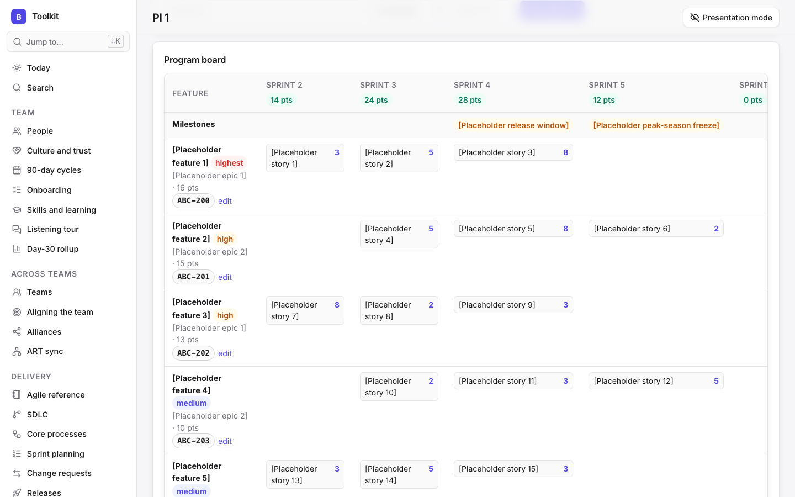
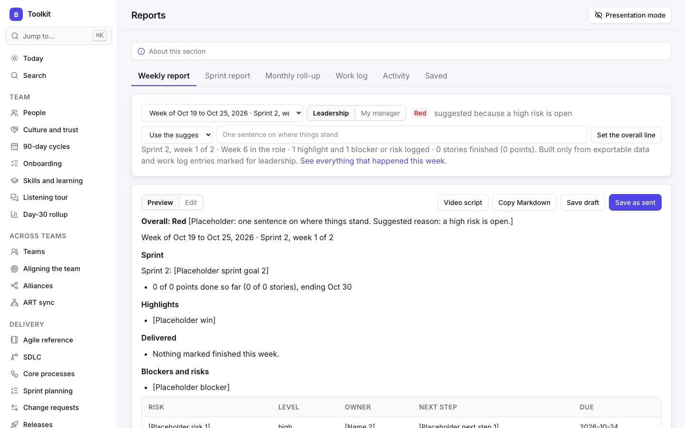
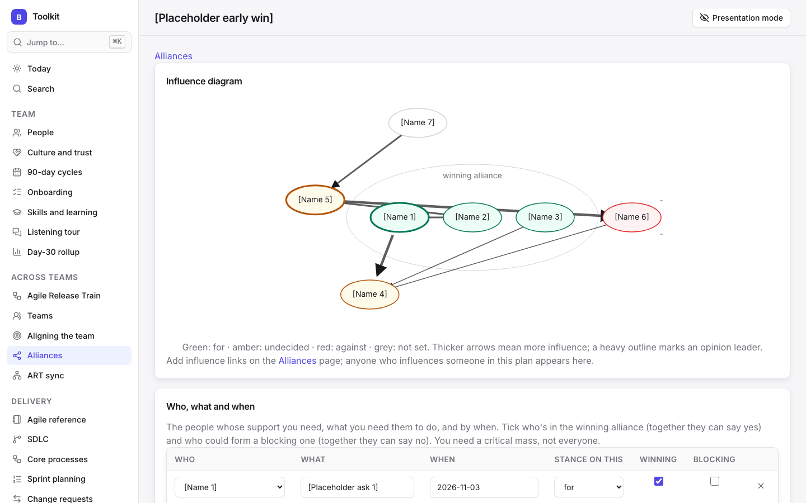
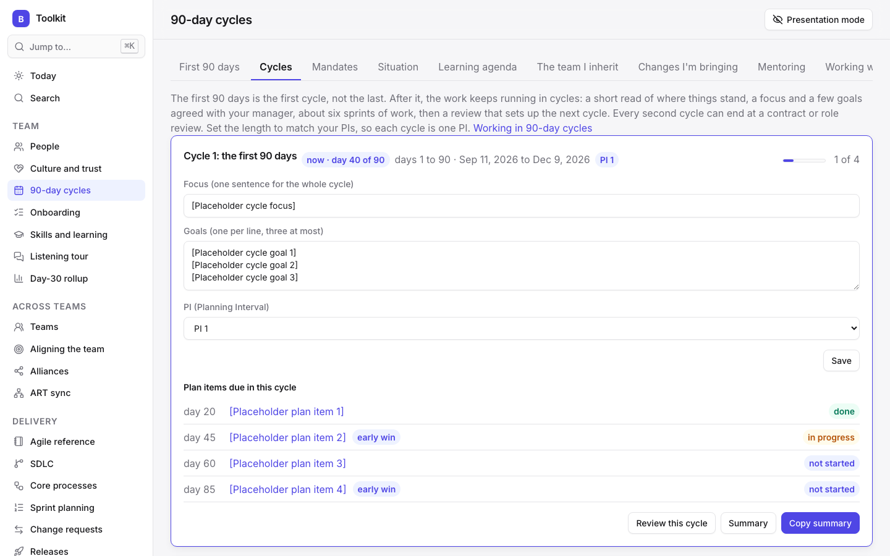
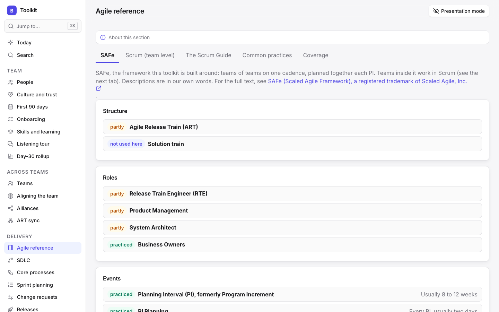
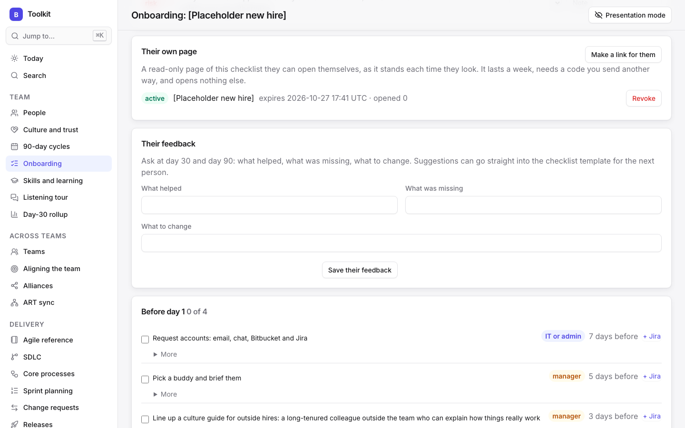
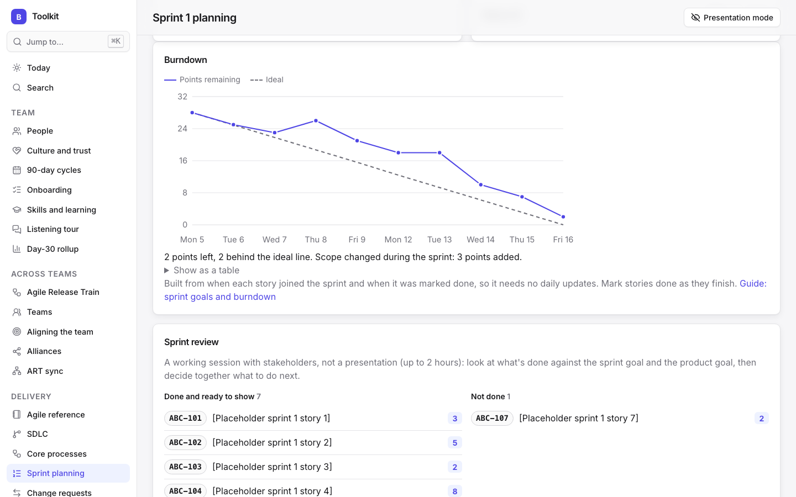

# beanagileorg

[](https://github.com/plutado/beanagileorg/actions/workflows/ci.yml)
[](LICENSE)
[](pyproject.toml)

**Envisioned and created by [David Plutado Fugate](https://davidfugate.com).**

**Be an Agile organization.** A private, context-rich advisor for engineering managers. beanagileorg is a local-first workbench for an individual engineering manager: one place to run your team's delivery, look after your people and report upward, without stitching together documents, spreadsheets and chat. It assumes SAFe as the organization's framework, with each team working in Scrum, and plans your own work in 90-day cycles of strategy and execution, starting with the first 90 days in a new role.

In a typical week it helps you:

- **Start each day knowing what needs you.** Today lists overdue tasks and follow-ups, one-on-ones this week with a drafted agenda, releases due soon that aren't ready, reports due and milestones in your plan, and suggests coaching from what's happening.
- **Run the team's rhythm.** Sprint planning against real capacity, ceremony notes, retros whose commitments are checked next time, PI planning with objectives and a program board, and an ART sync log with an owner and date on every cross-team item.
- **Look after your people.** One-on-ones, growth paths, onboarding for new hires and a record of conversations, with judgments about people kept on your machine and never in anything you share.
- **Report without extra meetings.** A weekly status draft built from what's already recorded, sprint and monthly reports, delivery metrics against outside benchmarks, and decks and updates from the Comms studio.
- **See risks and decisions in one place.** Risks, go/no-go release calls, decisions and who made them, so nothing depends on memory.

Two small web apps run on your own machine: a **Toolkit** for leading the team and its delivery (sprints, retros, the backlog, PI planning, the ART sync, people, plans and reports), and a **Comms studio** for the updates and decks that make progress visible. Everything is stored in a SQLite file on your disk, the apps listen on localhost only, and every field carries a privacy level, so you can share your screen in a meeting without exposing private notes. No account, no cloud service and no telemetry.

**A two-minute walkthrough** (narrated, placeholder data):

https://github.com/user-attachments/assets/f906cc07-34af-40fc-9b03-c959b42b93e9

| | |
| --- | --- |
|  |  |
| **PI planning**: the program board, with features by sprint, points and milestones | **Reports**: a weekly status drafted from what's logged, with a suggested overall status |
|  |  |
| **Alliances**: an influence diagram colored by stance, with the winning alliance | **90-day cycles**: a focus and goals for each cycle, lined up with the PI |
|  |  |
| **Agile reference**: SAFe first, with how far each part is practiced | **Timed sharing**: a page shared through a link that expires and needs an access code |
|  |  |
| **Comms studio**: the reveal.js deck builder | **Sprint burndown**: points remaining against the ideal line, with scope changes, built from the change log |

All screenshots use placeholder data (`scripts/demo_data.py`, captured with `scripts/screenshots.py`); every value in brackets is invented.

## Who it's for

People responsible for making Agile real, not just named: a manager bringing Scrum to a team that has been working ad hoc, a Scrum Master who wants the events, artifacts and commitments to actually work, or a leader asked to spread good practice across the teams of an Agile Release Train and run its ART sync. It suits someone running an established team week to week as well as someone starting a new leadership role (the first 90-day cycle, listening tour and 30/60/90 plans are built for that). It also suits a leader building a learning culture: reports, presentations, retros and decisions accumulate into a library drawn from the same records, so progress can be tracked over time and shared with the team, stakeholders and the wider business. Everything stays in one private place instead of scattered across documents, spreadsheets and chat.

## Becoming an Agile organization

How the toolkit maps onto the work of adopting Agile:

| | Where it lives |
| --- | --- |
| **Start from the definition.** Import the official Scrum Guide into your own data, read it together in four planned team sessions, and see the definition of Scrum first. | Agile reference |
| **Know where you stand.** SAFe concepts, every Scrum accountability, event, artifact and commitment, and common practices, each marked as practiced, partly or not yet, with a coverage view of the gaps. | Agile reference |
| **Run the events.** Sprint planning against capacity and a sprint goal, the daily scrum's follow-ups, sprint reviews and retrospectives whose commitments are reviewed next time. | Sprint planning, Dev-sync log, Sprint notebook, Retrospectives |
| **Keep the artifacts honest.** One refined, estimated product backlog beside Jira, sprint backlogs, a definition of ready and a definition of done, with QA built in. | Sprint planning, QA resources, SDLC |
| **Bring change in well.** Each change announced with its reason, tried for a set time, reviewed with the team and then kept or dropped, in waves rather than all at once, with team agreements and the behaviors you want to shift. | 90-day cycles, Culture and trust |
| **Read the situation.** Diagnose each area as a start-up, turnaround, accelerated growth, realignment or sustaining success, and lead change at the pace each needs. | 90-day cycles |
| **Make the case with facts.** Delivery metrics beside outside benchmarks such as DORA, sprint and weekly reports, and updates that need no meeting. | Metrics, Reports, Comms studio |
| **Plan as a train.** PI planning with objectives, a program board and the confidence vote; an ART sync with owners and dates on every cross-team item; 90-day cycles that line up with PIs; and support for mentoring other managers as they adopt the practices. | PI planning, ART sync, Teams, 90-day cycles |

## Status

Actively developed. It works end to end and has a test suite that runs on every push, but it is young: the database schema may still change between versions (upgrades are applied automatically on start), and there are no tagged releases yet. Back up your data before pulling a new version (`beanagileorg backup all`).

## Quick start

You need [uv](https://docs.astral.sh/uv/) (on macOS or Linux: `curl -LsSf https://astral.sh/uv/install.sh | sh`; see its docs for Windows). uv fetches Python 3.12 or later for you if it isn't already installed.

```bash
git clone https://github.com/plutado/beanagileorg.git
cd beanagileorg
uv sync
uv run beanagileorg toolkit    # http://127.0.0.1:8801
uv run beanagileorg comms      # http://127.0.0.1:8802, in a second terminal
```

The first visit to each app asks you to choose a password (at least 12 characters); each app has its own. An authenticator code (TOTP) can be added later under Settings.

To look around without entering anything real, press **Load placeholder data** on the Toolkit's empty Today screen, and **Load placeholder deck** under Decks in the Comms studio. Every placeholder value is in brackets so it can't pass for real data.

Data goes to `~/.beanagileorg/<app>/`. To try the apps against a throwaway folder instead, set `BEANAGILEORG_DATA`:

```bash
BEANAGILEORG_DATA=/tmp/beanagileorg-demo uv run beanagileorg toolkit
```

## Search and Ask

**Search** needs nothing extra. Open Search in the sidebar, or press ⌘K (or /), type a word or two and choose *Search everything*. It's a keyword search over every record you can see, best matches first, grouped by kind, each linking to the record.

**Ask** answers questions in plain sentences ("what's overdue?", "who haven't I talked to this month?"), with links to the records it used. It needs a model. Under the hood it uses the same search, plus tools to read records and lists, so nothing needs indexing by hand: the index is built in memory from your data and rebuilt automatically whenever something changes.

To set Ask up with a local model:

1. Install [Ollama](https://ollama.com) and pull a model that supports tool calling, for example:

   ```bash
   ollama pull qwen3.6:35b-a3b
   ```

   Larger models answer better but need more memory; a smaller tool-calling model works on modest hardware.
2. In the app, open **Settings → Ask**. Keep the provider as OpenAI-compatible, the address as `http://127.0.0.1:11434/v1`, and set the model name you pulled.
3. Ask a question from the box on Today (Toolkit) or This week (Comms studio).

Any OpenAI-compatible server works the same way (LM Studio, vLLM, a hosted endpoint). Anthropic is supported too: choose it and paste an API key, which is stored in a file in your data folder readable only by you, never in the database or the browser. A cloud provider sees shareable data only unless you explicitly allow more; even then, judgments about people (assessments, one-on-ones, interviews, culture notes, influence and stances) stay on this machine unless you allow those separately. A question that itself sounds like a judgment about someone asks before it goes to a cloud model, and every question sent to one is logged under Exports. With a local model, an option unloads it after each answer to free memory.

Image generation in the Comms studio is also optional: point it at any local server with an OpenAI-style images API (the default address is `http://127.0.0.1:8710/v1`). Infographics need no model.

## Built with

- **Python 3.12+** with **FastAPI** and **Uvicorn**, and **SQLite** through the standard library. Three runtime dependencies in total.
- **Plain JavaScript** front ends with no build step for the apps themselves.
- **Tailwind CSS v4** (standalone CLI) for one shared design system with light and dark themes; the built CSS is committed.
- **reveal.js** for decks, **lottie-web** (light player) for animations, **highlight.js** for code blocks, **Lucide** icons and the **Inter** typeface, all vendored with their licenses so the apps work offline.
- **uv** for environments and the lockfile, **pytest** for the test suite.
- Optional: a local model through **Ollama** or any OpenAI-compatible server for Ask, and a local image service for generated illustrations.

## Features

### Everywhere

- **Local and private by default.** Each app listens on localhost only and keeps its data in a SQLite file outside the repository.
- **Privacy levels.** Every field is tagged private, presentable or exportable, and the server filters every read. New fields default to private.
- **Presentation mode.** One switch (or Shift+P) before sharing your screen hides every private field on every screen, enforced on the server.
- **Sign-in.** One password per app, an optional authenticator (TOTP) and a throttle on failed attempts.
- **Scoped API tokens** for LLM clients and the other app: `export:read`, `present:read`, `full`, plus app scopes such as `delivery:write`. No token reads judgments about people or records marked never share unless you also give it `judgments:read`, which asks first.
- **Change log and export log.** Every data change records the field, old and new value and who made it (you or a named token), and every export records what went out.
- **Design system.** Tailwind CSS v4 tokens with light and dark themes, Inter type, Lucide icons and responsive layouts.
- **History.** Records you write in (notes, meeting summaries, guides, decisions, policies, stories and more) keep every saved change, compared line by line, with a way to restore an earlier version.
- **Code blocks.** Paste code between triple backticks in any longer text box (Apex, SOQL, LWC markup, JSON, YAML and more) and it's kept exactly as pasted and shown like a code editor, with a copy button.
- **Jira keys.** Anything tracked in Jira (dev-sync items, risks, roadmap items, tests and test failures, incidents, retro commitments, onboarding items, vendor concerns, decisions, stories and tech debt) can carry its Jira keys, which link straight to the issue once the Jira address is set. Find a Jira key shows everywhere a key is mentioned.
- **Built-in guidance.** Every section explains its purpose and how to use it at the top of the page, and the Help page gathers them into one guide.
- **Command palette and shortcuts.** ⌘K or / jumps to any screen or runs an action; ? lists the shortcuts.
- **Backups that are checked.** `beanagileorg backup all` snapshots each app's data and restores it to a scratch folder to prove it's good; `beanagileorg restore` puts one back without deleting what was there; `beanagileorg schedule` sets up nightly backups. See [docs/backups.md](docs/backups.md).
- **Local domain.** Open the apps at https://toolkit.beanagile.org and https://comms.beanagile.org on your own machine, with Caddy and local certificates; requests addressed to any other name are refused. See [docs/local-domain.md](docs/local-domain.md).
- **Share with another manager:** share a small, chosen part of what you hold with another manager through a pack file, without either of you getting into the other's copy. Under Export, pick the kinds of record (nothing is chosen to start), then the records (one by one or by filter), then the fields; private fields need their own tick, some fields never leave, and links to people and teams go as a name or not at all, and a metric carries its readings. Review exactly what's in the pack, then download or copy it. Wording that may be a judgment about a person ("can't be trusted", "resistant"), touch on someone's employment or pay, or be personal information is flagged record by record for a second look: rewrite it, leave the record out with one click, or confirm before it goes; the importer sees the same flags, and flagged records start as skipped. Under Import, a preview shows each record as new, changed, conflicting (both sides changed the same field) or unchanged, field by field, and you decide for each: add, update with theirs, keep mine, merge field by field, add as a copy, or skip. Importing the same pack again changes nothing; a newer pack updates rather than duplicates. Each imported record shows who it came from, and the Log keeps every pack in and out. A pack can be signed with a passphrase you agree with the other manager another way, so they can tell it wasn't changed on the way; a signed pack needs the passphrase to import. Kinds so far: role templates, SDLC policies, regression plans, risks, decisions, ART sync items, core processes, and metrics with their readings (readings merge by adding what's missing, never removing). More to follow (see the plan in docs/specs).
- **Judgments about people stay with you:** assessments, interviews, one-on-ones, culture notes, influence maps, alliance plans, reflections, and the fields on a person that record your read of them (stance, influence, motivations, personal context, support notes) never go into a pack or a roster file, and stay hidden while presenting (your own backup still holds everything). Free text that does leave is checked for wording that sounds like a judgment of someone, touches on employment or pay, or is personal information, and you confirm before it goes: packs and rosters in both directions (an incoming roster's impressions and labels can be brought in or left out, and support notes and stances never come in), every Copy of a report, plan, agenda, summary or release note, Comms studio messages, and questions to a cloud Ask model. Add your own words under Settings → Words that need a second look. API tokens (and so the hub) never receive judgments about people unless you grant `judgments:read`. Any risk, decision, ART sync item, process, metric, policy, regression plan, role template, dev-sync item, change request, tech debt item or team change can be marked **never share**: you still see it, but it's hidden while presenting and left out of reports, packs, tokens and cloud models. A coaching guide, Facts, not judgments, explains why. See docs/specs/judgments-about-people.md.
- **Design specs.** The company-neutral plans the apps were built from, plus what's still to come: the video message platform, granular sharing between managers' installs, and keeping judgments about people from leaving. See [docs/specs](docs/specs/README.md).
- **Placeholder data.** One click fills empty parts of an app with bracketed `[Placeholder]` values for trying things out.
- **Search.** A keyword search over every record you can see, from the sidebar or the command palette, with no model needed.
- **Ask.** A question box answers plain-language questions from the app's own data, with links to the records it used. Any model: a local one through Ollama by default, any OpenAI-compatible server (LM Studio, vLLM, Odysseus) or a hosted provider, set under Settings. The model reaches the data through search and lookup tools at your privacy level; a cloud provider gets shareable data only unless you allow more, and judgments about people only if you allow that too; every cloud question is logged, and a local model can be unloaded after each answer to free memory.

### Toolkit

**Team**

- **Today:** an Ask box, a quick work log, and what needs you: overdue tasks and dev-sync items, what's due this week, obligations, one-on-ones and check-ins, commitments, change requests waiting, reports due, culture follow-ups and today's standard, 90-day cycle milestones and check-ins, mandate reviews, quiet peers, people named on your systems you haven't met yet, vendor renewals and learning goals at risk. A Coaching this week card suggests guides from what's happening (overdue retro commitments, an open high risk, low energy three reflections running, sprints short of commitment, and more), with a prompt of the week; one-on-ones this week link to a drafted agenda.
- **People, a private CRM:** a page for everyone you work with: title, location, contact, who they report to, teams, how they like to communicate, what motivates them, things to remember and key dates. Log every one-on-one, meeting and call with notes, takeaways and follow-ups; see relationship health against a check-in cadence, a Before you meet summary and a timeline across the toolkit. Choose which fields to use; sensitive notes stay masked until you show them, and private fields never appear while presenting. Under Fields, export People as a roster file another manager can import into their own copy (your team or everyone; shareable fields by default, private fields only if you tick them and confirm a list of the impressions and labels that would go; notes, conversations, feedback, assessments, support notes and every field that records your judgment of a person never), and import one the same way. Each person can carry their own Working with me, in their words.
- **Manager tools:** mark yourself, and your direct reports get a Manager tab: growth goals, a log of praise, feedback, wins and concerns (marked shared or not), and a drafted one-on-one agenda. A Managing themselves tab holds what each report chooses to share about how they're managing (energy, load, what's hard, what would help, patterns they recognize, disciplines they're working on, who supports them), only once you've recorded their consent; a summary for HR holds only the check-ins they agreed to share, and is logged. Or give one named HR contact a timed, read-only link to the same summary: it expires (an hour to seven days), can be limited to a few views, needs an access code sent another way, locks after five wrong codes, stops working the moment consent is withdrawn or you revoke it, and every view is logged. The page opens nothing else in the app, and only where HR can reach this computer (for example over a private network, with its address added to BEANAGILEORG_ALLOWED_HOSTS). Private: never presented, packed, read by a token or sent to a cloud model. Commitments both ways on anyone's page (what you owe them, what they owe you), with yours due and theirs late on Today.
- **Org chart:** reporting lines drawn from each person's Reports to, with every person a link to their page.
- **Placeholders and rosters:** stand-in people in [brackets] until you know who they are, marked and filterable; a real name clears the mark and keeps their history. Import a whole team from a roster file: people, reporting lines, team membership and which record is you.
- **Relationship balance:** your conversations split up (your management chain), down (your reporting line), sideways (peers) and outward, against the period before, with peers listed quietest first. Each person can carry what you can offer them, what you need from them, what they expect from you, and the kind of advice you go to them for. Today nudges when conversations skew upward or a key peer goes quiet. Each peer shows what you owe each other and their open ART sync items.
- **Culture and trust:** your standards (one shown on Today each day, with a weekly self-check), a private log of what you notice (intimidation, chaos from missing process, quiet voices, blame, and the good moments), a trust pulse over time, team agreements, a role brief, **behaviors to change** (the patterns that stand in the way, such as lack of focus or discipline, and how you want people to work instead), a **culture map** that reads each unit (your team, a team you're integrating, the wider organization) in three layers (what's visible, everyday norms such as how influence, meetings, conflict and recognition work, and the assumptions about power underneath), and a **glossary** of the local language. Upward questions logs what the team wants leadership to answer: anonymous or not (who asked stays private), who it went to, the answer, how many days it took, and when the team heard back; Today reminds you to chase answers older than two weeks and to tell the team. Growth paths set out each track's levels, what's expected and what moves someone up, with (privately) where each report sits.
- **90-day cycles:** work runs in 90-day cycles of strategy and execution. The first cycle, your first 90 days, shows three tracks side by side by day number: yours (plans, listening tour, reflections), each new hire's onboarding, and the team you inherit, whose first 90 days with you get milestones, a "Working with me" page, a plan for how you'll engage each audience in your first days, check-ins at days 30, 60 and 90 (each with an informal 360 on how you're adapting), team decision deadlines (the day you'll reach conclusions about the team and the day you'll act, with reminders on Today), a two-track view of organizational alignment and team building moving through the same four stages together (what is, what should be, how to get there, getting there) with a warning when one runs ahead, a reminder to recognize the key people you can't afford to lose early, a private assessment of each person you inherit (a first impression kept as written, then a considered view scored 1 to 5 on competence, judgment, energy, focus, relationships and trust with evidence, weighted by your own criteria, flagged when below your threshold, with an A, B or C placement and the role they've played in the group, plus how critical the position is (a B or C player in a critical role is flagged), fit with the situation, a judgment note, a role template, and where they stand: keep in place, keep and develop, move, replace, or observe, which only changes from observe once you're 90% sure; a replace shows the alternatives to try first and a reminder to treat the person with respect; and whether they're moved more by push or pull), notes on the team as a whole (alliances, who defers to whom, how consistent the one-on-one answers were), how the team worked before you (roles people played, meetings, who decided what, whether core meetings were too inclusive or too exclusive, and your predecessor's style next to yours), six closing questions on building the team answered from what you've filled in, role templates for judging people in unfamiliar functions (what to measure, what it should and shouldn't show, questions, warning signs; starters for developers, Salesforce, integration and QA), and a visible list of the changes you're bringing (announced, tried, reviewed, then kept or dropped), grouped into waves, with a warning when too many are under way at once, and a readiness check on each (awareness, diagnosis, vision, plan, support) that says whether to plan and implement or to build the missing piece together first. Also: mandates for you and each report (purpose, outcomes, decision rights, proposals and open questions, agreed with a review date), a situation diagnosis per area (start-up, turnaround, accelerated growth, realignment or sustaining success, each with its usual mood, your job with it, its pace, and its typical challenges and opportunities, plus how the area got here, a warning when areas need different paces, and a portfolio view that sorts your areas into the five situations with a share of effort for each, checks that the kind of situation you most enjoy isn't getting the most effort by default, and copies as Markdown to share; turnarounds and realignments also show how to lead change in each: learning, intent, priorities, team, early wins and alliances; each situation notes whether it calls for a hero or a steward, and the portfolio checks that against your own style and shows your team's mix), a learning agenda (starter questions on the business, the people, the culture, the history and how decisions really get made, which turn into hypotheses to test as you learn, with a warning when technical questions crowd out culture and politics), a view of whose perspective you're learning from (customers, vendors, the frontline, integrators, natural historians and more) and which gaps remain, a checklist of structured ways to learn, a phased learning plan from before day 1 to day 60 (including two reviews of your hypotheses with your manager), conversations with your manager (where each stands and its priorities for the next 30 days, your manager's top three priorities, three things for the next one-on-one, what they're protective of, a resource menu of what each level of support buys, how they like to work, and what to ask them for given your situations), the same five conversations with each of your reports (situation, expectations, resources, style, development) with status and priorities, the managers you mentor, and a Momentum card. Near day 90, a summary for your manager draws on all three tracks and the delivery scorecard. Answered learning questions become business landscape points in one step, and themes the listening tour keeps raising suggest new questions. A team change records the agreement or SDLC policy it became, and the change list copies as one page the team can read. Mandates keep a snapshot when agreed (and whenever you ask, such as day 30 and day 90) to compare what was agreed with what stands now, and each outcome shows the plan and roadmap items serving it. Every cycle after it keeps the same rhythm: a focus, up to three goals, the plan items and wins due in its days and the PI it lines up with, then a review in its last two weeks (the delivery scorecard kept as it stood, a mandate snapshot, what went well, what to change and the next focus) and a one-page summary for your manager. The length is 90 days by default or matched to your PIs, Today prompts for the review and the next focus, and the core challenges check comes round at each cycle end.
- **Onboarding:** a checklist template by track (Salesforce, MuleSoft, QA, employee, contractor) from the week before day 1 to day 90, copied for each new member with real dates, progress, items for you, the buddy and IT, a materials list, and a Markdown checklist to send them. Hires from outside the company get a business orientation and a culture guide as well as a buddy. Items due for you show on Today. Each onboarding has a type (new hire, contractor, move between teams, promotion, lateral move) that adds set check-ins at days 7 and 60 and items for that kind of move (a promotion covers the old role, early training and what success looks like at the new level), a support team (buddy, mentor or culture guide, HR contact), and a Set up to succeed check against the common ways organizations set people up to fail, partly filled in from the toolkit. A new member can get a timed, read-only page of their own checklist, and their feedback turns into checklist template items for the next person.
- **Transitions:** a heat map of where people are joining, moving or stepping up, by unit and major change, with evidence from your teams (who started recently, onboardings in progress, open seats), a check of the support that exists today, what hiring has taught you, and a common core kit: a one-page playbook in the toolkit's shared language and a 90-day plan template for any new person.
- **Open seats:** a role you're hiring for, with its situation, how much transition risk you can accept and what it takes to fit in. Each candidate's transition risk is noted in the interview; hiring creates the person and an onboarding that carries those risks, and at day 90 Today asks which risks were real, so your picture of the culture sharpens with each hire.
- **Development grid:** every role and project by function and situation, for you (My development) and for each report (their page). Blank columns show situations not yet led through. Private.
- **Skills and learning:** the four kinds of knowledge a team runs on (individual expertise, working together, core technology, and knowing where to go), each summarized from what the toolkit holds: skills only one person has, agreements and practices in force, systems with no backup or documentation, vendors and other sources. Each core process lists the skills it needs, and coverage shows red where nobody has one and amber where only one person does. A list of gaps and underused resources, sorted into quick fixes and longer work, each with a plan; a list of where to go for outside knowledge; a skills matrix; and matches between who can teach and who wants to learn, each proposable as a group learning session.
- **Listening tour:** one record per one-on-one with the same five questions every time (what's working, what's frustrating, what to change first, what not to change, and what they'd focus on in your place), two optional follow-ups (strengths and weaknesses of how we work today, and resources we could use better), private clues (words, tone and body language, hot buttons, what wasn't said, whether they volunteered information, whether they own problems or point elsewhere), a private note on how each person answered, plus systems mentioned, gaps, opportunities and themes. Private end to end.
- **Day-30 rollup:** themes ranked by how often they come up, with supporting quotes, gaps, opportunities and "don't change" notes, copyable as Markdown for the written diagnosis.

**Across teams**

- **Teams:** your team and the teams you work with or oversee, with members, roles, Jira project, current sprint and goal, and a dated status. Delivery records carry a team, each team numbers its own sprints, and a team picker filters the delivery screens.
- **Aligning the team:** goals broken into parts, each with an owner or the whole team and a from, a to and a date, linked to Metrics, with a warning when a goal can't be measured; push and pull tools (after Figure 7-2) with how your people prefer to be motivated and advice for your situations; the incentive equation as five questions that suggest the mix of non-monetary and monetary, fixed and performance-based, individual and team rewards, with a Scrum note; a vision builder with seven sources of inspiration, three tests and the question of why people would put in extra effort, plus what's non-negotiable and what's open to the team, stories and channels, two or three core themes with a log of each time you use one, and a check that you're living it; and an offsite planner (six purposes, two at most, foundations before vision and strategy, and who should facilitate).
- **Alliances:** an alliance plan for each early win: who you need, what you need them to do, by when, and where each stands; the winning alliance (who together can say yes) and any blocking alliance; an influence diagram drawn from those people and anyone who influences them (after Figure 8-1), colored by stance, with arrow weight showing strength and a heavy outline for opinion leaders; pivotal people with their motivators, the forces pushing and holding them, the choices they believe they have, why they resist or are undecided, and what you could offer; framing for each pivotal person (logos, ethos, pathos) with a check on whether the ask clashes with their values, commitments or reputation; an influence strategy with counterarguments to head off, how to shape the choice, a step-by-step path, who to see in what order, and action-forcing events that show on Today; a playbook for supporters, opponents and persuadables; seven closing questions answered from what you've filled in; plus an influence network (who influences whom, on what), power coalitions, and opinion leaders and sources of power on each person's page. Private. A stakeholder map plots influence against stance from what you've noted on each person, with what each of you offers and needs on hover.
- **ART sync:** the cross-team log (SAFe's coach sync, close to a Scrum of Scrums) of questions, dependencies, decisions, risks, impediments and knowledge, each with stakeholders, an owner, the outcome expected and a date; meetings that walk every open item; and a summary for the layer above.

**Delivery**

- **Agile reference:** SAFe first (agile release trains, planning intervals, PI planning, the IP iteration, system demo, inspect and adapt, ROAM, WSJF and more), then every Scrum accountability, event, artifact and commitment as the team-level way of working (with timeboxes), then the practices teams commonly add (refinement, definition of ready, estimation, velocity, working agreements, Scrum of Scrums and more). Where SAFe and Scrum name the same thing differently, the toolkit uses one word and notes the other (a sprint is SAFe's iteration). Once the Scrum Guide is imported, each Scrum entry shows the guide's own wording with a link to its section; otherwise entries carry clearly labelled summaries in original words. Each links to where the toolkit supports it, and records how far the team practices it and how; a coverage view shows the gaps. The Scrum Guide itself can be imported from scrumguides.org into your own data (or pasted in), read by section with its Creative Commons attribution, shown on screen, and studied with the team in four planned reading sessions; the Scrum tab opens with its definition of Scrum and any other definitions you add.
- **SDLC:** how work moves from idea to production: stages with when each starts and when it's done, who's involved and what it produces; environments and the promotion path for Salesforce and MuleSoft; policies from draft to agreed; change history; and the whole thing as one Markdown document to share. Each stage names the RACI decisions that govern it, and the document keeps a version whenever a policy is agreed.
- **Releases:** one record per release: its branch and sprint, the stories in it (filled from the sprint, with their Jira keys), where it is on the path to production (step names from your SDLC environments or your own list, never hard-coded), the regression plan and QA sign-off, a go/no-go decision against a readiness check (stories done, regression signed off, QA sign-off, every step before production done), logged under Risks and decisions with who decided and any checks still open, and how it went (clean, hotfix, rollback or incident). Accepted change requests link to the release they landed in, so its scope history is complete, and appear in the release notes under "Added during the sprint". Copy release notes as Markdown. A calendar shows releases beside the regression windows in your QA plans and flags any release planned inside a Salesforce release window or a peak-season freeze. The release log gives deployment frequency, change failure rate and time to restore (from incidents linked to failed releases), which you can record as readings under Metrics; Today flags releases due within a week that aren't ready, and released ones with no outcome yet.
- **Core processes:** the ways the team turns work into value, each with an owner, how much it matters to the strategy, and whether it aims at flawless execution (spell out the means) or innovation (spell out the ends). Rate productivity, timeliness, reliability and quality, linked to the matching metrics; mark three at most as focus now. A workflow map, drawn as swimlanes by person or group and started from the SDLC if you like, shows bottlenecks and failing handoffs in red, and any of them can become a dev-sync item or a risk. The alignment check's processes section shows your focus processes.
- **Sprint planning:** a product goal at the top (the long-term objective each sprint goal steps toward), the backlog of candidate stories and SAFe enabler stories beside Jira (paste keys and titles, with user-story and enabler templates), refined against a definition of ready (with optional INVEST checks) and estimated together with team votes; then plan each sprint from who's available and recent velocity, pull ready stories up to capacity, set the goal, commit, and close the sprint to carry unfinished work over. Once committed, a burndown shows points remaining each working day against an ideal line, with scope added or removed along the way; it's rebuilt from when stories joined the sprint and were marked done, so it needs no daily updates, and it also appears in the sprint report. The sprint review panel lists what's done to show and what isn't, copies an agenda, and turns each piece of stakeholder feedback into a backlog item, so the review adjusts the backlog. The Scrum timeboxes for your sprint length sit at the top. A plan summary copies back to Jira.
- **Sprint notebook:** sprints with goals and dates, a private note per ceremony (planning, refinement, review, retro, dev sync, ad hoc, PI planning, end-of-PI demo) with prompts for what happened, what you noticed, implementation thoughts and follow-ups. Follow-ups become dev-sync items tied to the sprint, and anything still open shows in the next sprint's notebook.
- **Planning Intervals:** PIs made of development sprints and an Innovation and Planning (IP) sprint, with 90-day cycles that can follow them.
- **Retrospectives:** a shared board per sprint in four formats, with votes and topic tags; commitments with owner, due date and status, tagged to the sprint they came from; each retro opens by reviewing earlier commitments; a running improvement backlog and a list of topics that keep coming back. The board shows the team's agreed agreements, flagging any due for review. The most helpful commitment can go straight onto the backlog as a ready item for the next sprint.
- **PI planning:** objectives with planned and actual business value and predictability; epics, features and stories with priority, acceptance criteria, points and ticket keys; a program board by sprint with capacity checks and milestones; dependencies, ROAM risks and the confidence vote. Presentable throughout.
- **Roadmap:** Agile adoption items with target days that turn into real dates once your start date is set, plus status and owner. Drag rows to reorder them. The Timeline view lays the roadmap out by day of the role, one lane per kind, with today marked and status shown by color; drag an item sideways to change its target day. Items can serve a mandate outcome and show there as progress.
- **RACI:** decisions by role, with editable roles, a confirm status per row and a check for exactly one accountable person. The decision rights from your mandate show beside the chart, and each decision shows the SDLC stages it governs.
- **Tech debt:** a register classified by what fixing each item buys (maintainability, stability, performance, cleanup, revenue and conversion, observability, security, delivery speed, cost), scored by impact, risk and effort into quick wins, big bets, fill-ins and money pits; an agreed share of sprint capacity checked each sprint; a decision log with revisit dates; and a shareable summary for leadership.
- **Risks and decisions:** risks by level, owner, next step and due date, and decisions needed with who decides, when, how it's decided (decide alone, consult and decide, build consensus, unanimous), whether you've told people the process, and the outcome. A short guide suggests a process from four rules of thumb and your situations, with reminders to run a fair process and never fake consensus. **Look for predictable surprises** walks four areas (the outside world, customers and strategy, inside the team, politics) with prompts, plus a reminder to join up silos; anything you spot becomes a risk tagged with its area. A decision log gathers every decision recorded anywhere in the toolkit (decisions needed, architecture, tech debt, change requests, releases, team changes, mandates), with who decided and how.
- **Metrics:** baseline, target, an optional outside benchmark with its source, and readings over time for each measure, with an on-target indicator. Starter metrics are cycle time, deployment frequency, change failure rate, time to restore, escaped defects, meetings per week and meeting reschedule rate. Each metric shows whether it's improving, holding steady or getting worse (from its last three readings and whether higher is better), on the Metrics page and in the weekly report. Trend charts show each metric over time against its baseline and target, with the latest value labeled, the value of any reading on hover, and the readings as a table you can tidy. A delivery scorecard puts the six-month bar in numbers: sprint commitments kept, release outcomes and change failure rate, and each measure against its baseline and target.
- **QA resources:** a manual test library anyone can follow (steps, expected result, owner, last result), test runs with pass, fail, blocked or skipped per case and failures sent to the dev-sync log, an inventory of automated suites (unit, Apex, MUnit, end-to-end) with coverage and latest result, regression plans for each Salesforce release and peak-season freeze with owner, backup and sign-off, and the definition of done.
- **Dev-sync log:** every question raised after standup, with its kind (question, offer to present, decision needed, idea, action), who raised it, experts, decision maker, owner, next action, due date, status, origin and private notes. Overdue items stand out, and the group-learning flag proposes a presentation. Rows switched onto the dev-sync board copy out with only their shareable columns, and Make an update drafts a short script for a recorded update on any row.
- **Change requests:** work that arrives mid-sprint, logged with its source, urgency, size and effect on the sprint goal; the sprint's capacity and unfinished stories beside it; a decision on Scrum's terms (swap, absorb, defer, reject, cancel the sprint) that moves the stories; a record of when the requester heard; a team policy; and scope change per sprint. Who asks shows, by person and by source, how many requests came in, what share was accepted, deferred or declined, and how many were emergencies. Our policy can be copied as a short summary for stakeholders, with the last few sprints' numbers and how to ask.
- **Group learning:** a schedule of short team presentations, fed by the dev-sync log and by teach/learn matches.
- **Vendors:** type, status, account contacts, support process, service promise, contract dates and renewal notice; commercial terms stay private. A private conversation log, open concerns with owners, and follow-ups that become dev-sync items.

**Reporting**

- **30/60/90 plans:** one plan per month for the first six months (add more for a finer step or a longer view), with a headline each and dates from the start date. Items are outcomes, actions, measures or things you won't change, each tagged with the listening-tour themes behind it. Early wins can be linked to the agreed outcome they serve and the behavior they start to change, with a flag on any that serve no outcome. Each can be scored with an early wins evaluation (four questions, 0 to 4 each), and candidates are ranked so you keep three or four. Each early win can be planned as a project with FOG LAMP (focus, oversight, goals, leadership, abilities, means, process), with a lead and team from People; change agents are marked on their pages, listed under 90-day cycles and offered first as project leads. A side panel shows which themes no item answers yet. Copy the outline as Markdown, or build a deck from it in the Comms studio. Marking a plan presented saves a version, and you can save one any time; "What's changed" compares a version with now or with any later version, listing items added, removed and changed. Each plan's header shows its check-in counts, and Today reminds you when a plan's last day has passed with items not yet checked in. At each checkpoint, check every item in as met, partly met, moved (to a new day or the next plan) or dropped, with a reason for anything moved or dropped, and copy a summary for the review.
- **Work log:** wins, progress, blockers, decisions, asks and what's next, noted as they happen, each for leadership, your manager or just you.
- **Weekly and sprint reports:** every date lands in its week, week in the role and sprint week (a two-week sprint has a week 1 and a week 2). A weekly report for any week, for leadership (exportable data only) or your manager, with a suggested overall color; a sprint report with the goal, points against commitment, what carried over, scope changes and each sprint week. Edit, copy, save, mark sent, or turn either into a short video script. Activity shows everything you moved forward in a week, with Add to log. Set the week's overall rating and line once and it carries into both the weekly report and the status draft; a monthly roll-up builds the month from the weeks; the report for your manager summarizes mentoring of the other managers.

**Knowledge**

- **Architecture and tools:** one catalog of the systems we run and the tools we build with (what each is, how we use it, environments, stack, docs, owner, lifecycle, criticality, private known issues); the integrations between them, including the middleware they pass through; a system map drawn from those integrations; numbered architecture decision records; and plain-language guides in Markdown.
- **Business landscape:** the products, services and internal platforms your company offers, with owner, customers, systems, vendors and maturity; the organization as a tree of divisions, departments and teams with leaders and people; a private assessment for each, taken outside first (threats and opportunities, then the weaknesses and strengths that bear on them, sometimes called TOWS), with evidence, source and confidence, and a combined matrix. Link a weakness or strength to its threat or opportunity and Priorities pairs them up: blunt the threats you're weak against, pursue the opportunities you're strong for. Any point or priority can become a roadmap item or a risk.
- **Organizational alignment:** a diagnosis of how an area's strategic direction, structure, core processes and skills fit together, drawn as an open system with the outside players around it and climate and culture at the center. Each element has prompts, a Scrum lens (Scrum practices stall when structure and incentives fight them) and links to the Teams, RACI, SDLC, Agile coverage and Skills pages. Direction gets its own check: mission (what), vision (why) and strategy (how), what you won't do, four questions on customers, capital, capabilities and commitments, and tests for coherence, adequacy, how it was made and implementation (judged by what people do, not what they say). A verdict says whether the problem is in the direction or in how it's carried out, and suggests what to do: leave it, adjust it modestly now and plan bigger changes later, or raise questions so it gets re-examined. Structure gets its own check too, with a caution that changing it moves power: its four parts (units, reporting lines and integration, decision rights, measures and incentives), the balances it strikes now and where they should be (central or local, standard or custom, fixed or performance rewards, individual or team incentives), and the common problems (silos of excellence, decision scope, incentives that reward the wrong thing, compartments or blurred accountability), each linked to RACI, the ART sync or Metrics. Mark where any two elements are out of step (the arrow turns red), pick the situation to see where to start (a turnaround starts with direction, a realignment with processes and skills), name the root cause, write the case to make when the fix sits above you, and keep the five traps in view. Six closing questions are answered from what you've filled in, ready to use as the outline of a read-out. Private.
- **Escalation playbook:** systems with owner, first responder, backup, business contacts linked to People, and linked vendor, business-hours and out-of-hours escalation chains, severity levels, and an incident log whose follow-ups become dev-sync items.

**Coaching**

- **Guides:** an editable library for engineering leaders in seven themes, with a strong focus on the transition into a new role: mindset, assertiveness, learning fast, the manager relationship, early wins, managing yourself and earning trust, plus joining from outside, your mandate, leading change, leading upward, culture and trust, peer relationships, change mid-sprint, team leadership, agile practice, stakeholders, leading leaders and vendors. Each guide has what to do, what to watch out for, questions to ask yourself and things to try this week. Rewrite, delete or add guides, and note what inspired them.
- **Coaching where you work:** guidance isn't confined to the Coaching section. Each screen offers tips and links to the guides that fit what you're doing there, and every new section ships with its own.
- **Tips on every screen:** a short coaching tip at the top of each landing page in both apps, linking to a guide, edited per screen, hidden while presenting. Detail pages (a retro, a person, an onboarding, a vendor, a change request, a dev-sync item, a release, a team) carry their own tips.
- **Reflection journal:** private prompts for each stage of the role, plus a Take stock set for a structured look at how the transition is going. Energy, confidence, in control and load over the role, with the common dip three to six months in shaded, a warning when load rises while energy falls, and a drawing of how pressure helps and then hurts performance. A reflection can be linked to the guide you're working on and shows on that guide's page.
- **Coaching packs:** share your guides, tips and prompts with other leaders (never your notes or reflections) and import theirs.

**Me**

- **My development:** learning goals with time logged and a report toggle that controls what reaches status reports, plus tasks, recurring obligations and your start date. My evaluation criteria makes explicit how you judge people: 100 points across competence, judgment, energy, focus, relationships and trust, one threshold where nothing else matters, a reflection on blind spots, whether you believe each criterion can be changed in someone, and how interdependent your team's work is, with what your situations mean for the people you need, kept over time.
- **Managing myself:** a core challenges check (one question per stage of the transition, around day 30, 60 and 90, with the weakest linked to its page and guide), a monthly transition self-check for four patterns (undefended boundaries, brittleness, isolation, work avoidance) with evidence and who you asked, personal disciplines (six suggested, or your own), a working-base checklist for the first weeks, and an end-of-day review on Today (planned, done, what matters tomorrow, disciplines kept) that covers the week on Fridays. All private.
- **Asks I'm considering:** log a request with when you'll answer, keep a reply that starts from no, then mark it declined or turn it into a task. Due answers show on Today.
- **Advice and counsel network:** a grid of who helps you, by kind (technical, cultural, political, personal) and by inside or outside the organization, with empty squares highlighted and a checklist of what a good network has.
- **Problem preferences:** a self-assessment of which kinds of problems you're drawn to, across five areas (people, finance, product and customers, delivery and operations, engineering) and three kinds (technical, political, cultural). Totals that fall noticeably below your strongest are flagged as likely blind spots, each with guides to strengthen it and a plan to compensate (discipline, a backstop from People, or an advisor). Name your "hammer" too: the strengths that could misfire in a new role. Earlier ratings are kept to compare.
- **Advice network:** mark people as technical, political or personal advisors; My development shows the mix and flags when political counsel or personal advice is missing.

**Starter content:** one click loads a generic Agile adoption roadmap, the five common RACI decisions and the delivery metrics.

### Comms studio

**Messages**

- **This week:** messages due from your rhythms, drafts in progress and recently sent.
- **Messages:** draft, review, ready, sent and archived states, with a saved version on every edit and one-click restore.
- **Writing checks** that run as you type. Leftover placeholders block "ready"; jargon is flagged with a plainer word (built-in list plus your own glossary); long sentences and a missing opening summary get warnings; About people flags wording that may be a judgment about someone or personal information. Copying, downloading or printing a message with such wording asks first.
- **Templates:** a starter kit of ten (weekly note, weekly status, alert, release notes, decision announcement, day-30 diagnosis, day-90 and quarterly review, team announcement, sprint review, video pitch), each with default audiences and channel.
- **Comms calendar:** rhythms (weekly, every two weeks, monthly, quarterly) that create due items with a start-drafting date and a one-click draft from the right template.
- **Sent log:** the exact text, channel, audiences and check results of everything marked sent.
- **Audiences and channels:** who needs what, at what level of detail, and where they usually hear it.
- **Exports:** copy as text, download Markdown or print to PDF, each logged.
- **Toolkit connection:** pull the toolkit's weekly status draft into a message, or build a deck from its 30/60/90 plans, over an export-only token.
- **Privacy:** drafts are private; sent messages are shareable.

**Presentations**

- **Deck builder:** a three-pane editor (slide list with drag to reorder, live reveal.js canvas, inspector) over slides stored as structured data.
- **Eleven layouts:** title, section break, one big number, points (optionally revealed one at a time), quote, comparison, image, video, audio, animation and closing.
- **Media players:** video and audio with trim start and end, loop, poster frame, captions, and play on entering the slide, on a click or only when pressed.
- **Lottie animations:** loop, play once, play on a click, speed and frame segments. The light player runs no expressions.
- **Versions and review:** save named versions, compare them slide by slide, restore one, and move a deck from draft to review to approved to presented, with each step saved. Approved decks are locked until you start a new draft; any saved version can be presented, and a deck can be copied for another audience.
- **Present:** full screen from the same renderer as the editor, with reveal.js's speaker view (notes, next slide, timer).
- **Media library:** uploads of video, audio, images, Lottie and WebVTT captions, with type checks, seekable playback, source and license recorded, and license details kept private.

**Visuals**

- **Images:** generate illustrations, slide backgrounds and thumbnails from a description through a local image service (FLUX.2 Klein on Apple Silicon by default), with a house style added to every prompt. Generated images are filed as such, with their prompt, model and seed.
- **Infographics:** big numbers, bars, timelines, steps, before and after, and progress, drawn from data rather than generated, so every word and number is exact. The local model can draft one from a request and the toolkit's facts; edit it with a live preview and export a crisp PNG to the media library.
- **Ask:** the same question box as the toolkit, with its own model settings.

## What's next

Headline items from the [backlog](BACKLOG.md), which lists everything planned in more detail:

- **Jira API sync:** read issue status and summary through a read-only Jira token so keys show live status, and import backlog, sprints and stories instead of pasting them.
- **MCP server:** expose the toolkit's search and lookup tools to local assistants and LLM clients, scoped like the existing API tokens.
- **Encrypted backups:** optional passphrase encryption of backup archives and a second backup location.
- **Guided tours:** a first-run tour per app and per-screen tours from the command palette, built on Driver.js (MIT) and bundled locally.
- **Accessibility pass:** a contrast check of every design token pair, screen reader labels, and focus order in dialogs.
- **Packaging for other managers:** a lighter install, a setup script, and export and import of practice packs, so other managers can run their own install without forking.
- **Timed sharing, wider:** the timed share link (built for HR summaries) extended to a read-only, presentable view of other screens, and to pulls between managers' installs.
- **Smarter Ask:** semantic search with local embeddings beside full-text search, streamed answers, and suggested questions on Today.

## Shared base (`src/beanagileorg/core`)

| Piece | What it does |
| --- | --- |
| Sign-in | One user per app: scrypt password, optional authenticator (TOTP), sessions in a hashed cookie, a throttle on failed sign-ins |
| Privacy levels | Every field is tagged private, presentable or exportable. Reads are filtered on the server; untagged fields count as private |
| Presentation mode | A per-session switch that hides private fields everywhere, for screen sharing |
| API tokens | Scoped tokens for LLM clients and the other app: `export:read`, `present:read`, `full`, plus app scopes such as `delivery:write` |
| Change log | Every data change records the field, old and new value, and who made it |
| Exports | One path that filters to exportable fields and logs what went out |
| Timed share links | One read-only page for one named person: expires in an hour to seven days, optional view limit, an access code sent another way, locks after five wrong codes, revocable, rendered fresh each time, every view logged. Served under `/shared/` with no sign-in and nothing else reachable |
| Judgments about people | One list of records and person fields that never leave; a guarded reader (API tokens, cloud models) skips them and records marked never share; wording checks before text leaves, with your own word list |
| UI shell | Navigation, routing, presentation toggle and a Settings screen for sign-in, tokens and history |

## Design system

Styles come from one Tailwind CSS v4 source, `src/beanagileorg/core/static/app.src.css`: design tokens (light and dark), base styles and the shared components. The built `app.css` is committed, so running the apps needs no build step. After editing the source, rebuild with:

```bash
./scripts/build-css.sh
```

The script uses Tailwind's standalone CLI from `.tools/` (not committed). Icons are a Lucide subset (`scripts/build_icons.py`), and the font is Inter; both are vendored with their licenses. Press ⌘K in either app for the command palette, or ? for keyboard shortcuts.

## Commands

| Command | What it does |
| --- | --- |
| `beanagileorg toolkit` / `beanagileorg comms` | Run an app (localhost only; `--port` to change the port, `--reload` for development) |
| `beanagileorg backup all` | Back up every app and check each backup |
| `beanagileorg backups toolkit` | List backups and their check results |
| `beanagileorg verify FILE` | Check a backup without changing anything |
| `beanagileorg restore FILE --app toolkit` | Put a backup back (stop the app first) |
| `beanagileorg schedule [--write]` | Nightly backups with launchd (macOS) |
| `beanagileorg domain [--caddyfile]` | Local beanagile.org setup |

## Data

Data lives in `~/.beanagileorg/<app>/` (override with `BEANAGILEORG_DATA`). Nothing in this repository is real data; examples and samples are always marked `[Placeholder]`.

Both apps run on their own. An [Odysseus](https://github.com/odysseus-dev/odysseus) hub is optional: set `BEANAGILEORG_ODYSSEUS_URL` and `BEANAGILEORG_ODYSSEUS_TOKEN` and the apps use it for documents, local models and scheduled jobs.

## Development

```bash
uv run beanagileorg toolkit --reload   # restart on code changes
uv run pytest -q                       # the test suite, also run by CI on every push
```

## License

MIT. See [LICENSE](LICENSE). Odysseus is a separate AGPL-3.0 project; these apps only talk to it over its API and include none of its code.
